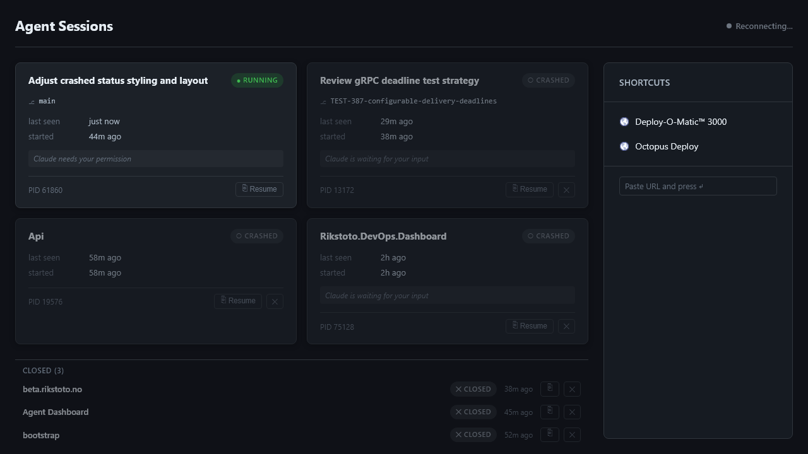

# Agent Session Dashboard

Live-updating web dashboard showing all active Claude Code sessions on your machine in real time.



---

## Prerequisites

- [Docker Desktop](https://www.docker.com/products/docker-desktop/) (or Docker + Compose)
- [PowerShell 7+](https://github.com/PowerShell/PowerShell/releases) (`pwsh`)
- Claude Code CLI

---

## 1. Start the Dashboard

```powershell
docker compose up -d
```

Dashboard runs at **http://localhost:5900**. SQLite data persists in a Docker volume across restarts.

To update after pulling changes:

```powershell
docker compose up -d --build
```

---

## 2. Install the Hooks

The hooks script posts session events from every Claude Code session to the dashboard backend.

**Run once from the repo root:**

```bash
# macOS / Linux
bash hooks/install.sh
```

```powershell
# Windows
pwsh -File hooks/install.ps1
```

Both do the same thing:
- Copy `session-reporter.ps1` and `session-reporter.sh` → `~/.claude/hooks/`
- Patch hooks into `~/.claude/settings.json` (Claude Code)
- Write `~/.copilot/hooks/session-dashboard.json` (GitHub Copilot)

**Linux/macOS** (`install.sh`) requires `jq` and `curl`. **Windows** (`install.ps1`) requires `pwsh`. The Copilot config includes both script variants so it works on any OS.

> **Restart Claude Code and VS Code** after installing for hooks to take effect.

### What the install script patches

**Claude Code** (`~/.claude/settings.json`):

| Hook | Event sent | Purpose |
|---|---|---|
| `SessionStart` | `started` | Register new session |
| `SessionEnd` | `closed` | Mark session closed |
| `PostToolUse` | `heartbeat` | Keep session alive (throttled 10s) |
| `Stop` | `heartbeat` | Heartbeat after agent turn |
| `SubagentStart` | `subagent-start` | Track subagent activity |
| `SubagentStop` | `heartbeat` | Heartbeat after subagent |
| `Notification` | `notification` | Surface last Claude message |
| `WorktreeCreate` | `worktree-create` | Track active worktree |
| `WorktreeRemove` | `worktree-remove` | Clear worktree on removal |

**GitHub Copilot** (`~/.copilot/hooks/session-dashboard.json`):

| Hook | Event sent | Purpose |
|---|---|---|
| `SessionStart` | `started` | Register new session |
| `Stop` | `closed` | Mark session closed |
| `PostToolUse` | `heartbeat` | Keep session alive (throttled 10s) |
| `UserPromptSubmit` | `heartbeat` | Heartbeat on each prompt |
| `SubagentStart` | `subagent-start` | Track subagent activity |
| `SubagentStop` | `heartbeat` | Heartbeat after subagent |

### Manual hook install (single account)

If you only have one Claude config or want to wire it yourself, add the following to `~/.claude/settings.json` (adjust the path if needed):

```json
{
  "hooks": {
    "SessionStart": [{ "hooks": [{ "type": "command", "command": "pwsh -NonInteractive -File \"~/.claude/hooks/session-reporter.ps1\" -Event started" }] }],
    "SessionEnd":   [{ "hooks": [{ "type": "command", "command": "pwsh -NonInteractive -File \"~/.claude/hooks/session-reporter.ps1\" -Event closed" }] }],
    "PostToolUse":  [{ "matcher": "", "hooks": [{ "type": "command", "command": "pwsh -NonInteractive -File \"~/.claude/hooks/session-reporter.ps1\" -Event heartbeat" }] }],
    "Stop":         [{ "hooks": [{ "type": "command", "command": "pwsh -NonInteractive -File \"~/.claude/hooks/session-reporter.ps1\" -Event heartbeat" }] }],
    "SubagentStop": [{ "hooks": [{ "type": "command", "command": "pwsh -NonInteractive -File \"~/.claude/hooks/session-reporter.ps1\" -Event heartbeat" }] }]
  }
}
```

---

## 3. Verify It Works

1. Open **http://localhost:5900**
2. Start (or use) any Claude Code session
3. A session card should appear within seconds

The `● Live` indicator in the top-right confirms the SSE stream is connected. If it shows `Reconnecting...`, the backend isn't reachable — check `docker compose ps` and `docker compose logs`.

---

## Session Statuses

| Status | Meaning |
|---|---|
| `running` | Heartbeat received in the last 30s |
| `idle` | No heartbeat for >30s, session still open |
| `closed` | `SessionEnd` hook fired cleanly |
| `crashed` | No `SessionEnd` + PID no longer exists |

---

## Decision Inbox (optional)

An async decision queue for stalled work items, rendered above the session grid. A
scheduled job posts up to three questions, you answer them on the startpage, and a later
run applies the answers. Each question carries the job's own recommendation and the
reasoning behind it, so you're reviewing a proposal rather than starting cold — and a
recommendation you disagree with tells you which guardrail to go fix. It stays advisory:
the applier acts on your answer and never on its own suggestion. Full design and
rationale: **[docs/DECISION-INBOX.md](docs/DECISION-INBOX.md)**.

The dashboard half needs no setup — the tables and endpoints ship with the container. To
turn the job on:

```powershell
# Requires: claude CLI on PATH and authenticated in ~/.claude, and `linctl auth` run once.
# Registering the task needs an elevated (admin) shell; running it does not.
pwsh scripts/register-decision-inbox-task.ps1
```

That registers a task running as **you** (not `SYSTEM` — `linctl` credentials are
per-profile), 3 minutes after logon and every 30 minutes thereafter, with the Claude
session's working directory set to the target repo so it has code context. Pass
`-IntervalMinutes` to change the cadence; a short one is close to free, since the runner
skips without invoking Claude whenever the pool is full and nothing is answered.

> **Two credentials, both per-user.** `linctl` reads `~/.linctl-auth.json`, and Claude
> reads its default config root `~/.claude`. The task runs as you, so it finds both — no
> `CLAUDE_CONFIG_DIR` to set. (An earlier setup pinned a non-default root explicitly; that
> is gone now that everything lives in `~/.claude`. If you ever run multiple config roots
> again, see the design doc for the pinning trap you'd need to handle.)

```powershell
Start-ScheduledTask -TaskName 'Decision Inbox'          # run it now
pwsh scripts/run-decision-inbox.ps1 -DryRun             # pre-flight only, no LLM
pwsh scripts/register-decision-inbox-task.ps1 -Unregister
```

By default no console window appears — the task uses the `S4U` logon type, which runs as
you in the non-interactive session. Pass `-ShowWindow` if you'd rather watch it work; that
uses `Interactive`, which pops a terminal to the foreground on every fire. Note that
`-WindowStyle Hidden` and the task's `Hidden` setting do **not** suppress the window; only
the logon type does.

Don't register a second task against the same runner — there's no lock on applying an
answer, so two concurrent runs can double-write to the tracker.

If the job stops working, the heartbeat line next to **Decisions** turns amber — an empty
inbox should never be mistaken for "nothing to decide".

---

## Local Development (without Docker)

```powershell
# Terminal 1 — backend (.NET 10 SDK required)
cd backend/AgentSessionDashboard
dotnet run

# Terminal 2 — frontend (Node 22+ required)
cd frontend
npm install
npx ng serve --proxy-config proxy.conf.json
```

Frontend dev server: **http://localhost:4200** (proxies `/api` to the backend on port 5000).

Build the frontend into the backend's `wwwroot` (same as Docker does):

```powershell
cd frontend
npm run build
```

---

## Environment Variables

| Variable | Default | Description |
|---|---|---|
| `DB_PATH` | `/data/sessions.db` | SQLite database path inside the container |

---

## Architecture

```
Claude Code (any session)
  └── Global hooks (~/.claude/settings.json)
        └── ~/.claude/hooks/session-reporter.ps1
              └── HTTP POST → localhost:5900/api/sessions/event

.NET 10 backend (ASP.NET Core)
  ├── POST /api/sessions/event   — receives hook payloads
  ├── GET  /api/sessions         — current session list (JSON)
  └── GET  /api/sessions/stream  — SSE stream of live updates

Angular 20 frontend
  └── Served as static files from .NET wwwroot (single container)
```

Single Docker container. One `docker-compose.yml`. SQLite on a named volume.

See [IMPLEMENTATION_PLAN.md](IMPLEMENTATION_PLAN.md) for full design detail.
